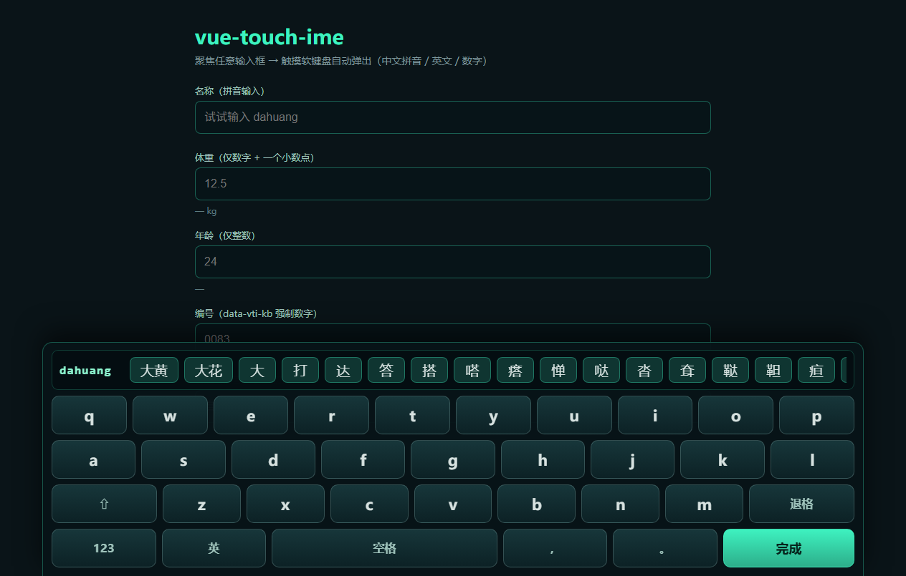

# vue-touch-ime

Vue 3 触摸屏软键盘（内置中文拼音输入法）——零接线焦点接管、按输入类型限制，适配无物理键盘的触屏工控 / 车载 / 自助终端 / 便携采集设备



## 功能特性

- **零接线接管** - 组件挂到页面根部后，文档级焦点监听自动接管所有文本输入框（聚焦弹出、失焦收起），无需逐个绑定
- **中文拼音输入** - 内置拼音词典（421 音节、汉字按字频排序 + 147 条常用短语），短语候选优先，支持一次上屏
- **输入类型限制** - 从 input 自身属性推断：`type=number` + 小数 `step` → 仅数字与一个小数点；整数 `step` → 仅数字；`inputmode` 同样生效；`data-vti-kb` 可显式覆盖
- **中 / 英 / 数 三模式** - 拼音、英文（单次大写）、数字键盘；数字与标点在拼音模式下直接上屏
- **v-model 友好** - 写值自动派发 `input` 事件，兼容 `v-model` 与 `@input` 受控写法
- **可换肤** - 一组 CSS 变量覆盖主色 / 背景 / 按键尺寸 / 圆角 / 字体
- **零运行时依赖** - 仅 peer 依赖 `vue`，拼音词典静态编译进包
- **单例 / 多实例** - 默认单例开箱即用，也可 `createSoftKeyboard()` 创建独立实例互不干扰

## 安装

```bash
npm install @junerver/vue-touch-ime
```

## 快速上手

```vue
<script setup lang="ts">
import { SoftKeyboard } from '@junerver/vue-touch-ime'
import '@junerver/vue-touch-ime/style.css'
import { ref } from 'vue'

const name = ref('')
const weight = ref<number | null>(null)
</script>

<template>
  <input v-model="name" type="text" placeholder="名称（试试输入 dahuang）" />
  <input v-model="weight" type="number" step="0.1" placeholder="体重（仅数字+小数点）" />
  <!-- 放在页面根部即可，输入框自动接管 -->
  <SoftKeyboard />
</template>
```

> 键盘只在挂载了 `<SoftKeyboard />` 的页面生效；不挂载的页面（如桌面大屏版）完全不受影响。

## 输入类型限制

| 输入框写法 | 键盘行为 |
| --- | --- |
| `<input type="number" step="0.1">` | 数字键盘，仅数字 + 一个小数点 |
| `<input type="number">`（整数 step） | 数字键盘，仅数字 |
| `<input type="text" inputmode="decimal">` | 数字键盘，仅数字 + 一个小数点 |
| `<input type="text" inputmode="numeric\|tel">` | 数字键盘，仅数字 |
| 其余文本输入框 | 拼音（可切英文 / 数字） |

### `data-vti-kb` 显式覆盖

属性推断不符时用 `data-vti-kb="text|decimal|digits"` 强制指定：

```vue
<!-- 编号输入框强制只接受数字（含前导零） -->
<input v-model="code" type="text" data-vti-kb="digits" placeholder="0083" />
```

> 注意：`type=number` 的输入框受浏览器值消毒约束（非数字内容会被直接清空），
> 中文请用文本输入框。

## 拼音输入说明

- 字母进入候选缓冲（顶部回显拼音，不进输入框），空格或点击候选上屏
- 候选顺序：短语优先（`dahuang` → 「大黄」），再按音节前缀从长到短出单字，单字按字频排序（`da` → 大 打 达…）
- `ü` 用 `v` 输入（`nv` → 女）
- 「完成」：整段拼音能被单个候选吃掉则上屏候选，否则按原始拉丁字母上屏（方便输入编号 / 编码）；随后收起键盘并触发输入框 `blur`
- 退格先删拼音缓冲，缓冲清空后删输入框内容

## 主题定制

### 快捷换肤：`accent` / `background` prop

```vue
<!-- 主色调换成橙色：完成键 / 高亮 / 派生色自动跟随 -->
<SoftKeyboard accent="#ff5500" background="rgba(20, 16, 12, 0.97)" />
```

| Prop | 类型 | 默认值 | 说明 |
| --- | --- | --- | --- |
| `instance` | `SoftKeyboardInstance` | 模块单例 | 自定义键盘实例（多键盘并存时用 `createSoftKeyboard()` 创建） |
| `accent` | `string` | `#3ef2c0` | 主色调（完成键 / 高亮 / 派生色自动跟随） |
| `background` | `string` | `rgba(7,20,24,0.97)` | 面板背景色 |

### 细粒度：CSS 变量

覆盖 `.vti-kb` 上的 CSS 变量即可（`--vti-accent-strong` 默认由 `--vti-accent`
自动派生，一般无需单独覆盖）：

```css
.vti-kb {
  --vti-accent: #3ef2c0;        /* 主色（高亮 / 完成键） */
  --vti-accent-strong: color-mix(in srgb, var(--vti-accent) 72%, #000); /* 派生暗端 */
  --vti-on-accent: #06241c;     /* 主色按键上的文字色 */
  --vti-bg: rgba(7, 20, 24, 0.97); /* 面板背景 */
  --vti-key-bg: linear-gradient(180deg, rgba(24, 56, 60, 0.95), rgba(13, 34, 38, 0.95));
  --vti-key-fg: #d7e2e0;        /* 按键文字 */
  --vti-key-h: 54px;            /* 按键高度 */
  --vti-key-radius: 10px;       /* 按键圆角 */
  --vti-font: "Microsoft YaHei", sans-serif;
}
```

## API

### 组合式

```ts
import { useSoftKeyboard, createSoftKeyboard } from '@junerver/vue-touch-ime'

const kb = useSoftKeyboard() // 模块单例
const other = createSoftKeyboard() // 独立实例

kb.state // reactive：visible / mode / kind / buffer / draft / replaceAll / shift
kb.candidates // 当前拼音候选（ComputedRef<SoftCandidate[]>）
kb.press('a') // 按键：单字符 | 'backspace' | 'space' | 'done' | 'shift' | 'mode:zh|en|num|back'
kb.pickCandidate(candidate) // 候选上屏
kb.openFor(inputElement) // 手动接管指定输入框
kb.close(blur?) // 收起键盘
kb.attach(root) / kb.detach() // 焦点监听挂载/卸载（组件内部已自动处理）
```

### 纯逻辑（`@junerver/vue-touch-ime/ime`）

不依赖 Vue，可在任意框架 / 原生页面复用：`resolveSoftKind` / `resolveSoftKindWithOverride` /
`candidatesFor` / `resolveBufferCommit` / `insertIntoTextInput` / `backspaceTextInput` /
`writeInputValue` / 数字草稿工具（`applyCharToDraft` / `draftToDomValue` 等）。

### 词典（`@junerver/vue-touch-ime/dict`）

`PINYIN_CHARS`（音节 → 汉字串，串序即候选序）与 `PINYIN_PHRASES`（拼音 → 短语）。

## 词典再生成

词典是构建期生成的静态资产（`src/pinyinDict.ts`，勿手工编辑）：

```bash
python scripts/gen-pinyin-dict.py
```

原料：Jun Da 现代汉语单字字频表（决定候选顺序）+ `pinyin` 包单字表（补全读音）+
脚本内维护的常用短语表。短语表可按业务领域增删后重新生成。

## 浏览器兼容

现代浏览器（Chrome / Edge / Safari），依赖 Pointer Events 与 CSS `color-mix`。
面向触屏设备使用；桌面端鼠标操作同样可用。

## License

[MIT](LICENSE) © junerver
